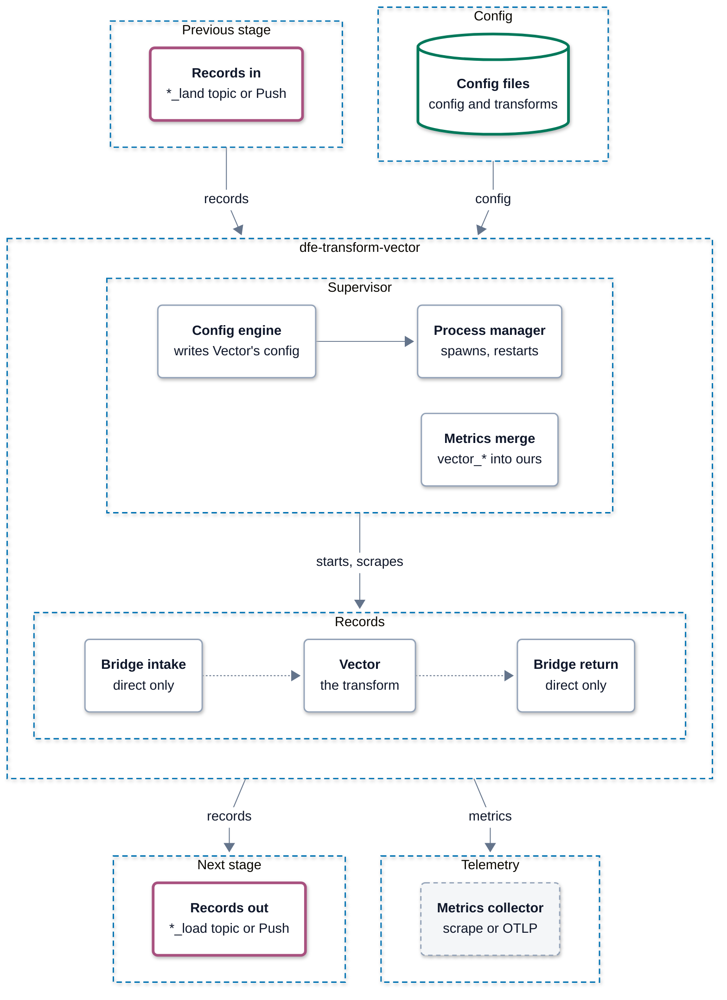

# dfe-transform-vector

Runs a Vector pipeline as a supervised transform stage in a DFE deployment.

[](https://github.com/hyperi-io/dfe-transform-vector/actions)
[](LICENSE)

## What it does

- Vector does the transform, and the supervisor supplies the rest a stage needs: config, credentials, health, metrics and restarts. Reach for it when you need one of Vector's transforms beyond `remap`. For VRL alone, [dfe-transform-vrl](https://github.com/hyperi-io/dfe-transform-vrl) runs it in-process with no Vector binary.
- One small YAML (pipeline name, brokers, topics, SASL and TLS) generates Vector's source, sink and observability config, so you write only the `transforms:` and `enrichment_tables:` blocks.
- Kafka (`bus`) or a direct gRPC push with no broker (`direct`), chosen for each end. The transform you author is the same on both.
- A crashed Vector is restarted with exponential backoff, and readiness follows it.
- With reload enabled, a transform change is validated, sent to Vector with a SIGHUP, and read back from Vector's reload counters as applied, refused (the running config is put back) or unconfirmed. One that fails validation is logged and never sent.
- Vector's `vector_*` metrics are merged into the supervisor's, so one endpoint and one OTLP push serve both.

The config engine and the process manager run Vector inside the pod, the bridge moves records on the direct transport, and the metrics merge serves Vector's metrics beside the supervisor's.



*Figure 1. L3 Components -- dfe-transform-vector. Dotted arrows are the direct transport. On the bus Vector reads and writes Kafka itself.* Up: top of dfe-transform-vector. Down: [dfe-transform-vector architecture](docs/architecture.md).

On `bus` Vector reads and writes Kafka itself and the bridge does nothing. On `direct` the bridge takes records from the previous stage's Push client and hands Vector's output to the next stage's Push listener.

## Quick start

```bash
cargo build --release --bin dfe-transform-vector
scripts/fetch-vector.sh        # caches the pinned Vector under .tmp/ and prints its path
./target/release/dfe-transform-vector --config config.example.yaml config-check
```

`--config` goes before the subcommand, and `run` is the default when you leave the subcommand out. To run it off the image, point `vector.binary` at the path `scripts/fetch-vector.sh` printed and `vector.config_dir` and `vector.data_dir` at directories you can write, then `./target/release/dfe-transform-vector --config config.example.yaml`.

[config.example.yaml](config.example.yaml) is the annotated reference. [templates/bus.yaml](templates/bus.yaml) and [templates/direct.yaml](templates/direct.yaml) are the whole Vector topology for each transport, commented per field and runnable as they stand: copy one, replace the `dfe_transform` step, and you have a working pipeline. In a deployment the supervisor generates `sources:` and `sinks:`, and rejects any other top-level key in a transform file.

| | `bus` | `direct` |
|---|---|---|
| In | Kafka `<source>_land` | a scalo Push listener on `source.listen` (port 6000 by default) |
| Out | Kafka `<source>_load` | a scalo Push client to `sink.endpoint` |
| Needs a broker | yes | no |

One port, 9090 by default, serves the ops surface: `/livez`, `/readyz` and `/metrics`. `/readyz` answers 503 until Vector has survived its first 500 ms, and again when it is down or its sink has held or refused records for `metrics.sink_stall_secs` without delivering any. A bus config with no topics idles instead: Ready, with no Vector running, until the config file names a topic. Vector's exporter defaults to `127.0.0.1:9598`. Keep `metrics.vector_metrics_address` on loopback, because nothing checks it.

## Configuration

The config file (`--config`, else `config.yaml` or `config.yml` in the working directory) sits over the defaults, and `DFE_TRANSFORM_VECTOR_*` environment variables sit over the file. The working directory's `.env` is read into the environment first, and a variable set before it wins. The flat names take a single underscore and a comma list (`DFE_TRANSFORM_VECTOR_SOURCE_BROKERS=a:9092,b:9092`, `_SINK_TOPIC`, `_TRANSFORMS_DIR`, the SASL pairs) and beat the double-underscore form. That form reaches any key and takes a list in brackets (`DFE_TRANSFORM_VECTOR_SOURCE__BROKERS='[a:9092,b:9092]'`), and a bare comma list there fails to load. `--log-level`, `--log-format` and `--metrics-addr`, or `LOG_LEVEL`, `LOG_FORMAT` and `METRICS_ADDR`, outrank `logging.*` and `metrics.address`. [docs/config-schema.yaml](docs/config-schema.yaml) lists the app's keys with their types and defaults.

With reload on, the default, a transform file change applies once it validates, with no restart. Any other change to the app's keys, `dfe_source`, `pipeline.name` and `scaling.pressure_threshold` included, is logged as needing a pod restart, and no later transform change applies until the pod restarts or the edit is reverted. scalo's sections in the file, such as `version_check`, `scaling.enabled` and `metrics.namespace`, are read once at startup, so an edit there needs a restart, and the watcher logs a successful reload without applying it. In a chart deployment a config or file set change rolls the pods anyway, because the chart hashes both into the pod template. The reload path is in [docs/internals.md](docs/internals.md), the readiness rules and the metrics merge in [docs/vector.md](docs/vector.md), and the Kafka settings in [docs/librdkafka.md](docs/librdkafka.md).

## Documentation

- [docs/architecture.md](docs/architecture.md): the parts, how data flows and why it is built this way.
- [docs/internals.md](docs/internals.md): the config engine and hot reload.
- [docs/vector.md](docs/vector.md): the Vector subprocess, health and metrics, and dead letters.
- [docs/direct-transport.md](docs/direct-transport.md): the bridge on the direct transport.
- [docs/reference/configuration.md](docs/reference/configuration.md): the config layers and the chart.
- [docs/migration.md](docs/migration.md): moving a pipeline off the official Vector chart.
- [docs/librdkafka.md](docs/librdkafka.md): the librdkafka settings Vector's Kafka source and sink are given.
- [tests/TESTING.md](tests/TESTING.md): the test tiers, and the e2e cases that need Docker and a Vector binary.

The suite's published docs are at <https://dfe.docs.hyperi.io>, and this repository's pages at <https://dfe.docs.hyperi.io/dfe-transform-vector/>.

## Help and contributing

How to work in this repo, the commands that test a change and what tends to bite are in [CONTRIBUTING.md](CONTRIBUTING.md). A question that is not a bug goes in an issue.

Open bugs: [this repo](https://github.com/hyperi-io/dfe-transform-vector/issues?q=is%3Aopen+is%3Aissue+type%3ABug+-label%3Abacklog+-label%3Anext-minor) | [whole DFE suite](https://github.com/search?type=issues&q=is%3Aopen+is%3Aissue+type%3ABug+-label%3Abacklog+-label%3Anext-minor+repo%3Ahyperi-io%2Fdfe-infra+repo%3Ahyperi-io%2Fdfe-docker+repo%3Ahyperi-io%2Fdfe-deploy+repo%3Ahyperi-io%2Fdfe-engine+repo%3Ahyperi-io%2Fdfe-loader+repo%3Ahyperi-io%2Fdfe-receiver+repo%3Ahyperi-io%2Fdfe-fetcher+repo%3Ahyperi-io%2Fdfe-archiver+repo%3Ahyperi-io%2Fdfe-transform-vrl+repo%3Ahyperi-io%2Fdfe-transform-vector+repo%3Ahyperi-io%2Fdfe-transform-elastic+repo%3Ahyperi-io%2Fdfe-ui+repo%3Ahyperi-io%2Fdfe-hyperdx+repo%3Ahyperi-io%2Fscalo-rs+repo%3Ahyperi-io%2Fscalo-py+repo%3Ahyperi-io%2Flogreducer+repo%3Ahyperi-io%2Fdfe-schemas+repo%3Ahyperi-io%2Fvector-vrl+repo%3Ahyperi-io%2Fculvert+repo%3Ahyperi-io%2Fdfe-clickhouse-rs+repo%3Ahyperi-io%2Ffactbook-rs)

## License

BUSL-1.1, see [LICENSE](LICENSE).
