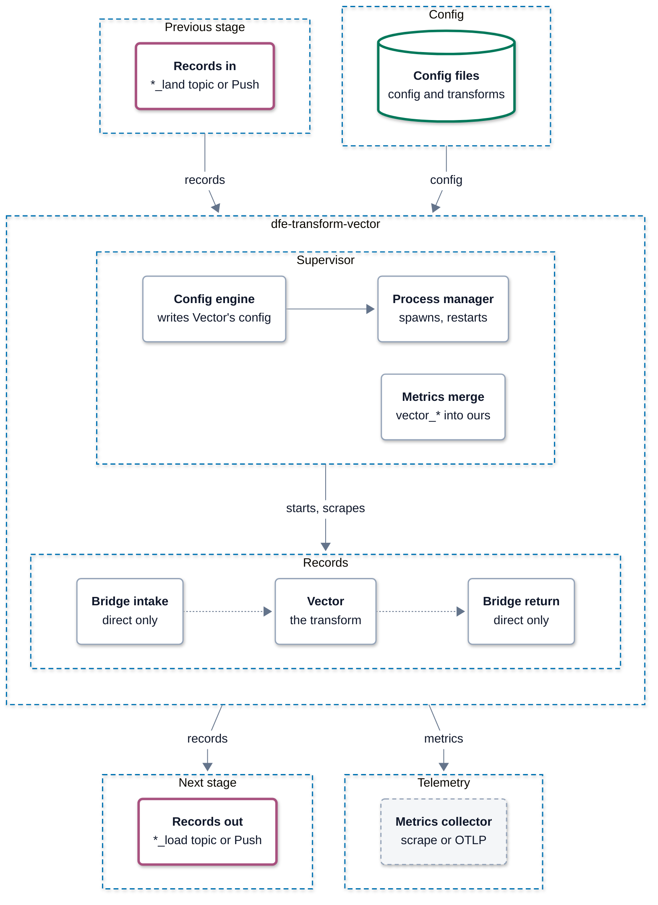

# dfe-transform-vector architecture

dfe-transform-vector runs a Vector pipeline as a DFE transform stage, for the transforms beyond VRL's `remap`. A Rust supervisor is PID 1 and gives Vector what every DFE app has: one config, one ops port, health, metrics and restarts.

*Figure 1. L3 Components -- dfe-transform-vector. The arrows between Bridge intake, Vector and Bridge return are the direct transport. On the bus Vector reads and writes Kafka itself.* Up: [L2 Services -- DFE deployment](https://github.com/hyperi-io/dfe-infra/blob/main/docs/architecture.md). Down: [L4 Detail -- Config engine](internals.md), [L4 Detail -- Vector](vector.md), [L4 Detail -- Direct transport bridge](direct-transport.md#how-it-works).

## How data flows

1. The **Config engine** turns the big-dial config and your transform files into a Vector config directory, wires the graph and runs `vector validate`.
2. The **Process manager** spawns **Vector** on that directory, and restarts it after a crash.
3. On the bus, Vector's `kafka` source reads `<source>_land`. On the direct transport, the **Bridge intake** takes Push calls on port 6000 and hands records to Vector over loopback.
4. Vector runs the transforms.
5. On the bus, Vector's `kafka` sink writes `<source>_load`. On direct, the **Bridge return** takes Vector's output and pushes it to the next stage.
6. The **Metrics merge** scrapes Vector's exporter and serves its `vector_*` series beside the supervisor's, on one port and one OTLP push.

## Components

| Part | Role | Page |
|---|---|---|
| Config engine | Builds and validates Vector's config, and reloads transforms | [internals.md](internals.md) |
| Process manager | Spawns Vector, forwards SIGTERM, restarts it with backoff | [vector.md](vector.md#how-it-works) |
| Metrics merge | Serves Vector's metrics with the supervisor's | [vector.md](vector.md#interfaces) |
| Bridge intake | Translates scalo `Transport/Push` into Vector's `PushEvents` | [direct-transport.md](direct-transport.md) |
| Vector | The upstream binary, at the version `VECTOR_VERSION` pins | [vector.md](vector.md) |
| Bridge return | Takes Vector's output and pushes it onward | [direct-transport.md](direct-transport.md) |

You write the `transforms:` and `enrichment_tables:` blocks. The supervisor generates the source, the sink and the observability config.

## External dependencies

| Dependency | Needed for | Swappable |
|---|---|---|
| Kafka | The bus transport, read and written by Vector | Any broker `source.brokers` and `sink.brokers` reach. Direct needs none |
| A DFE service over gRPC | The direct sink, `http://dfe-loader:6000` by default | Any stage running a Push listener |
| Dead-letter queue | Records over the next hop's size ceiling | `dfe_transform_dlq` on the bus, a file spool on direct |
| dfe-engine | Writing a deployment per source config | dfe-infra's `apps.yaml` declares the app, so the engine has no code for it |

## Deployment variants

| Variant | What runs |
|---|---|
| Docker `single` | On by default. One instance per source that binds a Vector transform |
| Kubernetes, every profile | When a deployment asks for it. One deployment per source config, KEDA sets replicas |

One Vector runs per pod, and replicas scale out. The released chart scales on CPU. dfe-infra's values add a pressure trigger in `single`, `scale` and `mesh`, but the gauge it reads stays 0 when Vector runs, so that trigger never scales a pod out and CPU does the scaling. Feeding it is tracked in <https://github.com/hyperi-io/dfe-transform-vector/issues/117>. Lag isn't a trigger, because it rises when a downstream stage breaks and more pods can't fix that.

The chart mounts the config and transform files, and an edit to either rolls the pods. Outside a chart, a transform change hot-reloads. [reference/configuration.md](reference/configuration.md) has the config layers and what the chart fixes.

## Design considerations

**Security.** Vector runs whatever a transform file declares, with read access to the Kafka credentials. So a transform file may declare `transforms` (never `lua`) and `enrichment_tables` alone, and a table must resolve inside `transforms.data_dir` and outside every credential path. A transform can't read a file, reach the network or inflate a record: no transform may set `file` or `files`, and the VRL host, network, file and decompression functions are refused before Vector sees them. A failed validate is logged as the components and error codes alone, never the source Vector quotes. Credentials reach Vector as `SECRET[...]` file references, never as values in its config. Vector runs without the `DFE_TRANSFORM_VECTOR_*` variables.

**Reliability.** Delivery is at least once on both transports. A crashed Vector restarts on an exponential backoff capped at a minute, with no crash limit. A failed bridge leg stops the process, because its senders would otherwise retry forever against a live pod.

**Operations.** `/readyz` means Vector survived 500 ms after spawn and its sink isn't stalled. A pod with an unreachable broker and nothing held stays Ready. Vector's exporter on 9598 is a loopback debug surface, and 9090 is the scrape target.

**Performance.** Vector's buffers have no memory cap of their own, so the pod's limit has to cover Vector's worst case. For VRL alone, [dfe-transform-vrl](https://github.com/hyperi-io/dfe-transform-vrl) runs in-process with bounded buffers.

## Why it's built this way

**A subprocess, not a library.** Vector has no stable API for embedding. Running the upstream release binary makes a Vector upgrade a version bump and an image rebuild, not a rebuild against every Vector release.

**One pin.** `VECTOR_VERSION` in `src/deployment.rs` feeds the Dockerfile, the default `vector.version` and the contract. `vector.version_check: strict` stops a pod whose config and binary disagree.

**Polling for reload.** S3-backed mounts (s3fs, goofys, Mountpoint for S3) raise no filesystem events, so inotify would work on a laptop and silently stop reloading in production.

**Wiring from labels.** The config engine reads each transform's `inputs` and joins `dfe_source` to `dfe_sink` through them, so a transform author never hand-wires the topology.

## Diagram map

- [Figure 1. L3 Components -- dfe-transform-vector](architecture.md)
  - [L4 Detail -- Config engine](internals.md)
  - [L4 Detail -- Vector lifecycle](vector.md)
  - [L4 Detail -- Direct transport bridge](direct-transport.md)

## What's next

- [config.example.yaml](../config.example.yaml), the annotated config, and [config-schema.yaml](config-schema.yaml), every key
- [reference/configuration.md](reference/configuration.md), the config layers and the chart
- [librdkafka.md](librdkafka.md), the Kafka client settings, and [migration.md](migration.md), moving off the Vector chart
- [CONTRIBUTING.md Context](../CONTRIBUTING.md#context), where things live and the commands that test a change
