# Architecture

Why this repo exists, what owns what, and the invariants you cannot read off a single file. Field-level detail is in [internals.md](internals.md).

## The problem

DFE needs a transform stage between its sources and its loader, and Vector does the per-record transform work well. What it lacks is the rest of a DFE app. Vector has its own config format, metrics endpoint, process lifecycle and idea of what "started" means. Every DFE app presents one control surface instead: a big-dial YAML, one ops port carrying `/livez`, `/readyz` and `/metrics`, an OTLP push, KEDA scaling and a chart assembled from its deployment contract.

So Vector is kept, and wrapped. The Rust supervisor is PID 1 and Vector is its child. The supervisor supplies the production half -- config, credentials, health, metrics, restarts -- and Vector does the transform.

## Why a subprocess

Vector is not designed as a library and has no stable public API for embedding, so the image downloads the upstream release binary at a pinned version and the supervisor spawns it with `--config-dir`. A Vector upgrade is then a version bump and an image rebuild, where a compiled-in Vector would mean rebuilding against every Vector release.

This DFE Rust app alone ships two binaries in its runtime image: the supervisor, which scalo's deployment contract builds, and `vector`, which has no slot in that contract. The Dockerfile is therefore generated by scalo and then spliced: `src/deployment.rs::emit_dockerfile()` puts `src/vector-layer.dockerfile` in before the generated `USER` line, with the version and the two archive checksums substituted.

The fragment is a Dockerfile rather than a Rust string literal so hadolint and shellcheck can read it.

## Who owns what

Most confusion here is a question asked of the wrong layer.

| Layer | Owns |
|---|---|
| Vector (the child) | Per-record transform work, the Kafka client on the `bus` transport, its internal metrics |
| This supervisor | Config assembly, process lifecycle and crash recovery, health reporting, the metrics merge, the direct-transport bridge, the deployment artefacts |
| dfe-engine | What the app IS -- it reads dfe-infra's `apps.yaml`, compiles the app's routing into its chart values and holds the config in its registry |
| dfe-infra | The image pin and the GitOps deployment |

Nothing about how this app is deployed is coded into dfe-engine. dfe-infra's `apps.yaml` declares it `per_config` with `scale_deployed: true` -- one deployment per source config, not a singleton, and KEDA drives the replica count. Its `default_in` list names `docker-single` alone, so any other deploy composition gets it when a deployment asks for it.

## The pieces

The pod's parts are in [Figure 1 of the README](../README.md). The config engine turns a handful of big dials into a Vector config directory: a global file, a source file, the user's transform files, a sink file and an observability file. The user authors only the `transforms:` and `enrichment_tables:` blocks. `wiring` parses the component labels and `inputs` references in those files and joins `dfe_source` to `dfe_sink` through them, so a transform author does not hand-wire the topology.

### Config assembly

The supervisor loads and validates the config, writes the secret files and the source, then wires the transforms, writes the sink and runs `vector validate` before Vector reads the directory.

```mermaid
---
config:
  theme: base
  look: neo
  fontFamily: Inter, -apple-system, Segoe UI, Roboto, Helvetica, Arial, sans-serif
  flowchart:
    curve: linear
    nodeSpacing: 40
    rankSpacing: 64
    padding: 18
    wrappingWidth: 280
    htmlLabels: true
  elk:
    preset: modelOrder
  themeVariables:
    fontSize: 15px
    lineColor: "#64748B"
    primaryTextColor: "#0F172A"
    clusterBorder: "#0072B2"
    edgeLabelBackground: "#FFFFFF"
  themeCSS: >-
    p{margin:0}
    .node[data-look] rect,.node[data-look] path,.node[data-look] polygon,.node[data-look] .outer-path{filter:drop-shadow(0 1px 2px rgba(15,23,42,.10)) drop-shadow(0 6px 14px rgba(15,23,42,.10))}
    .node rect{rx:10px;ry:10px}
    .cluster rect{rx:16px;ry:16px}
    .node .label div{min-width:150px}
    .node.decision .label div{min-width:0}
    .cluster[data-look] rect{filter:none}
    .nodeLabel{line-height:1.35}
    .nodeLabel b{font-weight:600;font-size:15px;letter-spacing:-0.01em}
    .nodeLabel span{font-size:12.5px;font-weight:400;color:#334155}
    .cluster-label span.nodeLabel{display:inline-block;background:#FFFFFF;color:#0B2A3F;border:1.5px solid #0072B2;border-radius:999px;padding:2px 12px;font-size:11.5px;font-weight:700;letter-spacing:.09em;text-transform:uppercase}
    .flowchart-link{stroke-width:1.75px}
    .labelBkg{background:transparent!important}
    span.edgeLabel{display:inline-block;background:#FFFFFF!important;color:#1E293B;border:1px solid #94A3B8;border-radius:999px;padding:2px 10px;font-size:12px;font-weight:500}
    span.edgeLabel p{background:transparent!important}
    .label-icon{width:20px;height:20px;vertical-align:-4px;margin-right:6px}
    .ingest .label-icon{color:#0E8A7D}
    .xform .label-icon{color:#7B4FB0}
    .load .label-icon{color:#0072B2}
    .bus .label-icon{color:#A8517F}
    .store .label-icon{color:#00785A}
    .ui .label-icon{color:#D9480F}
    .ext .label-icon{color:#64748B}
---
flowchart TB
    accTitle: L4 Detail -- Config assembly
    accDescr: The config is loaded through its cascade and validated, the secret files are written and the source is generated. The transform files are read and wired into a checked graph, the sink is generated, and vector validate gates the directory before Vector is started or sent a SIGHUP.

    subgraph s1["1 Prepare"]
        direction LR
        load["<b>Load cascade</b>"] --> check["<b>Validate config</b>"] --> secrets["<b>Write secret files</b>"] --> source["<b>Generate source</b>"]
    end
    subgraph s2["2 Wire and gate"]
        direction LR
        read["<b>Read transforms</b>"] --> wire["<b>Wire and check</b>"] --> sink["<b>Generate sink</b>"] --> gate["<b>vector validate</b>"]
    end
    s1 --> s2
  classDef ext fill:#F4F6F8,stroke:#94A3B8,stroke-width:1.5px,stroke-dasharray:5 4,color:#0F172A
  classDef ingest fill:#FFFFFF,stroke:#0E8A7D,stroke-width:3px,color:#0F172A
  classDef xform fill:#FFFFFF,stroke:#7B4FB0,stroke-width:3px,color:#0F172A
  classDef load fill:#FFFFFF,stroke:#0072B2,stroke-width:3px,color:#0F172A
  classDef bus fill:#FFFFFF,stroke:#A8517F,stroke-width:3px,color:#0F172A
  classDef store fill:#FFFFFF,stroke:#00785A,stroke-width:3px,color:#0F172A
  classDef ui fill:#FFFFFF,stroke:#D9480F,stroke-width:3px,color:#0F172A
  classDef decision fill:#FFFFFF,stroke:#9A6700,stroke-width:3px,color:#0F172A
  classDef error fill:#FFFFFF,stroke:#C2410C,stroke-width:3px,color:#0F172A
  classDef control fill:#FFFFFF,stroke:#334155,stroke-width:3px,color:#0F172A
  classDef part fill:#FFFFFF,stroke:#94A3B8,stroke-width:1.5px,color:#0F172A
  class load,check,secrets,source,read,wire,sink,gate part
  style s1 fill:none,stroke:#0072B2,stroke-width:1.5px,stroke-dasharray:6 4
  style s2 fill:none,stroke:#0072B2,stroke-width:1.5px,stroke-dasharray:6 4
```

*Figure 2. L4 Detail -- Config assembly. Read each stage left to right, then down.* Up: [L3 Components -- dfe-transform-vector](../README.md).

`run` assembles into `vector.config_dir`, and a [reload](internals.md#hot-reload) into `<config_dir>.next`. The wiring check rejects an undefined input, a transform `dfe_source` cannot reach and a cycle.

The process manager spawns Vector, forwards SIGTERM at shutdown, and restarts it after a crash with exponential backoff from one to sixty seconds.

## Runtime invariants

**Reload polls, and must.** The watcher polls rather than using inotify because S3-backed mounts -- s3fs, goofys, Mountpoint for S3 -- generate no filesystem notification events. Inotify would work on every laptop and stop reloading in production with nothing logged.

**Only transforms hot-reload.** A transform change is validated, SIGHUPed into Vector, and reported from Vector's reload counters, since the signal succeeds even when Vector rejects it. Everything else is set at startup -- the consumer, the Push listener, the bridge legs, the group id, the ops listener -- and needs a pod restart. A reload compares the app's config with the running one, so a restart-only change in the file blocks every later transform change until a restart or a revert. An edit to scalo's sections in the file is not compared: it logs a successful reload and waits for a restart.

**A push on the direct path is answered only once the next hop has it.** Both bridge listeners are built armed, so a push is held until the pipeline releases its records. A hop that rejects is retried until the hold runs out, and then the push is answered `Unavailable` and its sender retries. The holds nest, 18 s at the intake, 16.5 s on the leg back from Vector and 15 s per send onward, so an inner hop times out first and the outer one can still answer its sender. A record no resend could deliver is not resent forever: one over the next stage's message-size ceiling goes to the DLQ, or is dropped and counted with the DLQ off, and one Vector refused for good is released dropped and counted.

**Only the intake sheds under pressure.** The leg back from Vector drains everything the intake holds, so shedding it would stall the stage until the holds expired into duplicates. Both listeners lease held bytes on the runtime's memory guard.

**A failed bridge leg stops the process.** Its senders would otherwise retry for ever against a live pod, so the service exits non-zero.

**Transforms cannot reach the Kafka credentials.** Vector runs whatever a transform file declares, with read access to the credentials. So a transform file declares only `transforms` (never `lua`) and `enrichment_tables`, each table resolves inside `transforms.data_dir` after `..` and symlinks and outside every credential path (the config directory, a mounted `sasl.secret_dir`, a TLS key), and a `SECRET[...]` naming an assembler backend is refused. Vector runs without the `DFE_TRANSFORM_VECTOR_*` variables.

## Health and metrics invariants

**Port 9598 is a loopback debug surface, not a scrape target.** Vector's `prometheus_exporter` binds it. The supervisor GETs it on scalo's metrics interval and registers every sample on the registry scalo serves and pushes over OTLP, so one endpoint serves both. The merge is what makes the app's throughput counters non-zero, since Vector owns the Kafka client and the supervisor never sees a record on the bus transport.

**`/readyz` checks that Vector runs and its sink moves.** The gate is that the child was still alive 500 ms after spawn, which catches bad argv, an unreadable config and a pod in crash-recovery backoff, and that the sink has not held or refused records for `metrics.sink_stall_secs` without delivering any. A large program can take Vector longer than 500 ms to build, so the pod can report ready before Vector has finished starting. A pod with an unreachable broker and nothing held stays Ready. So does a bus config with no topics, which idles with no Vector running.

## Build, chart and licence invariants

**The Vector version has one source.** The constant `VECTOR_VERSION` in `src/deployment.rs` is substituted into the Dockerfile's `ARG VECTOR_VERSION`, and both `VectorConfig::default()` and the contract's `default_config` read it for `vector.version`. `vector.version_check: strict` stops a pod starting when the config's version and the binary's disagree, so a deployment that sets `vector.version` itself has to move it with the image. dfe-infra's `versions.yaml` records the same release as `services.vector`, and dfe-fetcher's container Vector extractor runs that image.

**`password` is a `String` on purpose, not a `SensitiveString`.** The config goes through a figment serialize-merge-deserialize round trip in `apply_figment_env()`, and `SensitiveString` serialises as `***REDACTED***`, which destroys the value in transit. The protection is elsewhere: the env var is masked in logs, `Debug` redacts the field, and no credential is written into the Vector config. The generated components name it `SECRET[<backend>.<key>]` and Vector's `directory` secret backend reads it from files: a mounted secret at `sasl.secret_dir`, or owner-only files the assembler writes under `<config_dir>/.secrets` from a credential given as text. The released chart takes the second path: its Kafka Secret arrives in `DFE_TRANSFORM_VECTOR_{SOURCE,SINK}_SASL_*`, and `<config_dir>` sits on the `run` writable path.

**Vector expands no `${VAR}`, and `vector validate` resolves no `SECRET[...]`.** Since 0.57 interpolation needs `--dangerously-allow-env-var-interpolation` or `VECTOR_DANGEROUSLY_ALLOW_ENV_VAR_INTERPOLATION`. The supervisor passes neither, but Vector inherits the pod's environment, so keep that variable unset. `validate()` rejects a `${...}` in a SASL credential. Validate would hand the broker the literal `SECRET[...]` reference, so the supervisor runs it with `--no-environment`, and a missing secret file fails when Vector starts, not at validate -- which is why the assembler checks `secret_dir` itself.

Vector is redistributed unmodified under MPL-2.0, which has two obligations -- ship the licence text and tell recipients where the source is. Both are discharged inside the image from the release archive's `LICENSE`, `NOTICE` and `licenses` tree, so the attribution always matches the exact binary shipped. Do not replace that with a separate download.

**No chart is committed.** At release, hyperi-ci emits the contract with `generate-artefacts` and assembles a thin chart from it on the scalo-service library chart at `release.helm.library`. [internals.md](internals.md#the-chart) lists what the contract fixes.

**The ScaledObject scales on CPU alone.** `contract()` sets `KafkaLagTrigger::disabled()`: consumer-group lag rises when a downstream stage breaks, and the library's lag trigger reads `config.kafka.*`, a block this app does not have, so the library will not render it. A deployment adds a trigger with the library's `keda.extraTriggers` value.

## Where the transports differ

`source.transport` and `sink.transport` each pick `bus` or `direct`, and the transform you author is identical on both. What changes is who hands the record over: on `bus` it is a Kafka topic and Vector uses its `kafka` source and sink, on `direct` there is no broker, the rest of DFE speaks scalo's `Transport/Push` and Vector speaks `vector.Vector/PushEvents`, so the supervisor's bridge translates in both directions over loopback. `templates/bus.yaml` and `templates/direct.yaml` are the whole topology for each, and `vector validate` passes on both as they stand. In a DFE deployment the supervisor generates the `sources:` and `sinks:` blocks, so a whole template mounted as a transform file is refused.

On direct a record enters at the intake listener, crosses Vector over loopback and leaves from the return listener, which sends a record over the next stage's size ceiling to the DLQ.

```mermaid
---
config:
  theme: base
  look: neo
  fontFamily: Inter, -apple-system, Segoe UI, Roboto, Helvetica, Arial, sans-serif
  flowchart:
    curve: linear
    nodeSpacing: 40
    rankSpacing: 64
    padding: 18
    wrappingWidth: 280
    htmlLabels: true
  elk:
    preset: modelOrder
  themeVariables:
    fontSize: 15px
    lineColor: "#64748B"
    primaryTextColor: "#0F172A"
    clusterBorder: "#0072B2"
    edgeLabelBackground: "#FFFFFF"
  themeCSS: >-
    p{margin:0}
    .node[data-look] rect,.node[data-look] path,.node[data-look] polygon,.node[data-look] .outer-path{filter:drop-shadow(0 1px 2px rgba(15,23,42,.10)) drop-shadow(0 6px 14px rgba(15,23,42,.10))}
    .node rect{rx:10px;ry:10px}
    .cluster rect{rx:16px;ry:16px}
    .node .label div{min-width:150px}
    .node.decision .label div{min-width:0}
    .cluster[data-look] rect{filter:none}
    .nodeLabel{line-height:1.35}
    .nodeLabel b{font-weight:600;font-size:15px;letter-spacing:-0.01em}
    .nodeLabel span{font-size:12.5px;font-weight:400;color:#334155}
    .cluster-label span.nodeLabel{display:inline-block;background:#FFFFFF;color:#0B2A3F;border:1.5px solid #0072B2;border-radius:999px;padding:2px 12px;font-size:11.5px;font-weight:700;letter-spacing:.09em;text-transform:uppercase}
    .flowchart-link{stroke-width:1.75px}
    .labelBkg{background:transparent!important}
    span.edgeLabel{display:inline-block;background:#FFFFFF!important;color:#1E293B;border:1px solid #94A3B8;border-radius:999px;padding:2px 10px;font-size:12px;font-weight:500}
    span.edgeLabel p{background:transparent!important}
    .label-icon{width:20px;height:20px;vertical-align:-4px;margin-right:6px}
    .ingest .label-icon{color:#0E8A7D}
    .xform .label-icon{color:#7B4FB0}
    .load .label-icon{color:#0072B2}
    .bus .label-icon{color:#A8517F}
    .store .label-icon{color:#00785A}
    .ui .label-icon{color:#D9480F}
    .ext .label-icon{color:#64748B}
---
flowchart LR
    accTitle: L4 Detail -- Direct transport bridge
    accDescr: The previous stage pushes records to the intake listener, which hands them to Vector over loopback. Vector's output comes back to the return listener, which pushes it to the next stage, or sends a record over the size ceiling to the DLQ.

    prev["<b>Previous<br/>stage</b>"]
    intake["<b>Intake<br/>listener</b>"]
    vec["<b>Vector</b>"]
    ret["<b>Return<br/>listener</b>"]
    next["<b>Next<br/>stage</b>"]
    dlq[("<b>DLQ</b>")]

    prev -->|Push| intake
    intake --> vec
    vec --> ret
    ret -->|Push| next
    ret -.->|too large| dlq
  classDef ext fill:#F4F6F8,stroke:#94A3B8,stroke-width:1.5px,stroke-dasharray:5 4,color:#0F172A
  classDef ingest fill:#FFFFFF,stroke:#0E8A7D,stroke-width:3px,color:#0F172A
  classDef xform fill:#FFFFFF,stroke:#7B4FB0,stroke-width:3px,color:#0F172A
  classDef load fill:#FFFFFF,stroke:#0072B2,stroke-width:3px,color:#0F172A
  classDef bus fill:#FFFFFF,stroke:#A8517F,stroke-width:3px,color:#0F172A
  classDef store fill:#FFFFFF,stroke:#00785A,stroke-width:3px,color:#0F172A
  classDef ui fill:#FFFFFF,stroke:#D9480F,stroke-width:3px,color:#0F172A
  classDef decision fill:#FFFFFF,stroke:#9A6700,stroke-width:3px,color:#0F172A
  classDef error fill:#FFFFFF,stroke:#C2410C,stroke-width:3px,color:#0F172A
  classDef control fill:#FFFFFF,stroke:#334155,stroke-width:3px,color:#0F172A
  classDef part fill:#FFFFFF,stroke:#94A3B8,stroke-width:1.5px,color:#0F172A
  class prev,next ext
  class intake,vec,ret part
  class dlq bus
```

*Figure 3. L4 Detail -- Direct transport bridge. The dotted arrow is the dead letter path.* Up: [L3 Components -- dfe-transform-vector](../README.md).

The intake listens on `source.listen`, Vector's `vector` source on `bridge.to_vector`, the return listener on `bridge.from_vector`, and the onward client dials `sink.endpoint`. A stage with one end on `direct` runs that half alone.
