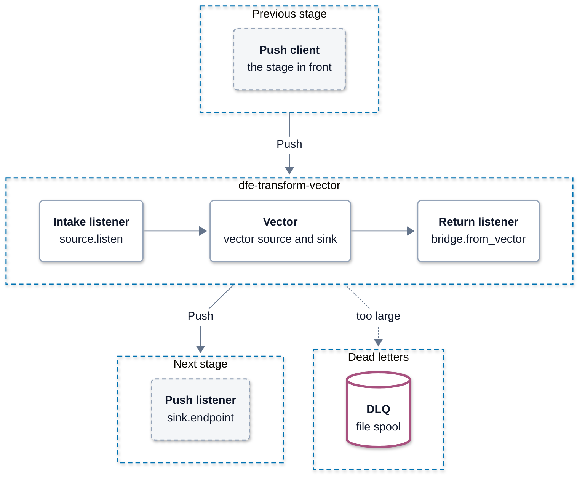

# Direct transport

The direct transport runs [dfe-transform-vector](architecture.md) with no broker. The supervisor's bridge translates between scalo's `Transport/Push`, which the rest of DFE speaks, and Vector's `vector.Vector/PushEvents`.

| | |
|---|---|
| Repo | [hyperi-io/dfe-transform-vector](https://github.com/hyperi-io/dfe-transform-vector), `src/bridge.rs` |
| Image and chart | `ghcr.io/hyperi-io/dfe-transform-vector`. The chart opens the Push port when `config.source.transport` is `direct` or `grpc` |
| Config reference | `source.transport`, `source.listen`, `sink.transport`, `sink.endpoint` and `bridge` in [config.example.yaml](../config.example.yaml). [templates/direct.yaml](../templates/direct.yaml) is the whole topology |
| Endpoints | Push listener on `source.listen` (`0.0.0.0:6000`). Loopback legs on `bridge.to_vector` (`127.0.0.1:6100`) and `bridge.from_vector` (`127.0.0.1:6101`) |
| Metrics | `pipeline_dead_letters_dropped_total{reason}` on `:9090/metrics` |

`source.transport` and `sink.transport` each pick `bus` or `direct`, so a stage can take Kafka in and push out, or the reverse. A stage with one end on `direct` runs that half of the bridge alone, and the transform you write is the same either way.

*Figure 1. L4 Detail -- Direct transport bridge.* Up: [L3 Components -- dfe-transform-vector](architecture.md).

## How it works

1. The previous stage pushes a batch to the intake listener.
2. The intake hands the records to Vector's `vector` source on `bridge.to_vector`, over loopback.
3. Vector runs the transforms, and its `vector` sink dials the return listener on `bridge.from_vector`.
4. The return listener pushes the records to `sink.endpoint`, or sends one over the next stage's size ceiling to the DLQ.
5. The intake answers its sender once the next hop has the records.

## Interfaces

In a DFE deployment the supervisor generates the `sources:` and `sinks:` blocks, so a whole template mounted as a transform file is refused. `templates/bus.yaml` and `templates/direct.yaml` both pass `vector validate` as they stand. Copy a template's `transforms:` block, not the file.

## Scaling and failure

Both listeners are built armed, so a push is held until the pipeline releases its records. A hop that rejects is retried until the hold runs out, then the push is answered `Unavailable` and its sender retries. The holds nest: 18 s at the intake, 16.5 s on the leg back from Vector and 15 s per send onward. An inner hop times out first, so the outer one can still answer its sender.

Only the intake sheds under memory pressure. The return leg drains everything the intake holds, so shedding it would stall the stage until the holds expired into duplicates. Both listeners lease held bytes on the runtime's memory guard.

A record over the next stage's size ceiling goes to the DLQ, or is dropped and counted with the DLQ off. A record Vector refused for good is released dropped and counted. A failed bridge leg stops the process with a non-zero exit, because its senders would otherwise retry forever against a live pod.

## Key metrics

| Metric | Healthy when |
|---|---|
| `pipeline_dead_letters_dropped_total{reason="too_large"}` | Flat. A rise is records over the next stage's ceiling with no DLQ |
| `pipeline_dead_letters_dropped_total{reason="rejected"}` | Flat. A rise is Vector refusing records for good |
| `records_delivered_total` | Tracks `records_received_total` |

## Related

- [Vector](vector.md), the process between the two legs
- [Config engine](internals.md), which writes the `vector` source and sink
