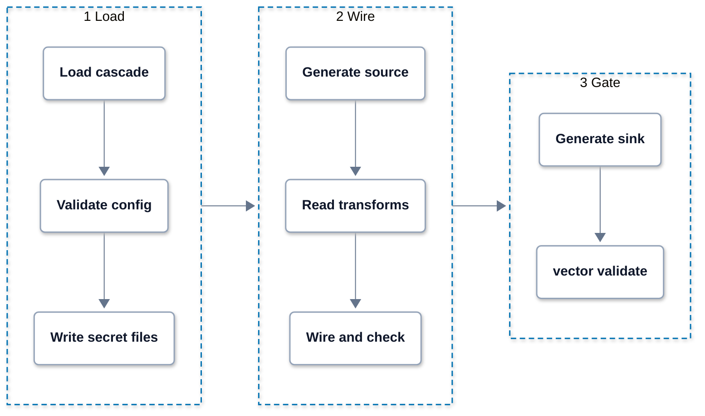

# Config engine

The config engine is the part of [dfe-transform-vector](architecture.md) that turns one small YAML and your transform files into the directory Vector runs on.

| | |
|---|---|
| Repo | [hyperi-io/dfe-transform-vector](https://github.com/hyperi-io/dfe-transform-vector), `src/config/` |
| Image and chart | `ghcr.io/hyperi-io/dfe-transform-vector`, and the thin chart each release assembles from `src/deployment.rs` |
| Config reference | [config.example.yaml](../config.example.yaml), [reference/configuration.md](reference/configuration.md) and [librdkafka.md](librdkafka.md) |
| Endpoints | None. It writes `vector.config_dir`, and stages a reload in `<config_dir>.next` |
| Metrics | `transform_vector_config_reloads_total{result}`, `config_reloads_total{result}`, `config_validation_errors_total` on `:9090/metrics` |

It runs at startup and again on every transform reload. Vector never reads a directory that failed `vector validate`.

*Figure 1. L4 Detail -- Config engine. Read each stage top to bottom, then right.* Up: [L3 Components -- dfe-transform-vector](architecture.md).

## How it works

`dfe-transform-vector --config <file> assemble <dir>` writes what `run` hands Vector, without starting it.

The wiring follows these rules:

- The source is always `dfe_source` and the sink always `dfe_sink`.
- A transform with no or empty `inputs` reads `dfe_source`, and an input written `source` becomes `dfe_source` in the file Vector reads.
- An input names a component (`parse`) or one of its named outputs (`split.accepted`). A `route` or `exclusive_route` has named outputs only, so a bare reference to one is refused.
- Every output nothing reads feeds the sink, through `dfe_size_cap` on bus, each unread route and its `_unmatched` included.
- A transform file declares only `transforms` and `enrichment_tables`. A `sources:` key, a `lua` transform, or a table outside `transforms.data_dir` or on a credential path is refused.
- A transform can't read a file, reach the network or inflate a record. A transform that sets `file` or `files` is refused, and so is VRL anywhere in one that calls `get_hostname`, `http_request`, `dns_lookup`, `reverse_dns`, `parse_proto`, `encode_proto`, `validate_json_schema`, `decode_gzip`, `decode_zlib`, `decode_zstd`, `decode_lz4` or `decode_snappy`, or passes `psl` to `parse_etld` or `alias_sources` to `parse_groks`. dfe-transform-vrl refuses the same functions.
- Every `inputs` reference must resolve, every transform must be reachable from `dfe_source`, and the graph must have no cycle. The error names the component: `component 'enrich' references undefined input 'parser'`.
- Once every enrichment table file proves readable, `vector validate --no-environment` over the directory is the last gate. Its failure is reported as the components Vector named and their VRL error codes. Vector's report quotes the failing source, so none of that is logged.

## Interfaces

| File | What it holds |
|---|---|
| `00_global.yaml` | `timezone: UTC`, `data_dir`, the API switch, one `directory` secret backend per credential source |
| `00_source.yaml` | `dfe_source`: a `kafka` source on bus, carrying the librdkafka layers in [librdkafka.md](librdkafka.md), or a `vector` source on `bridge.to_vector` on direct |
| `50_NNN_<file>` | Each transform file, in filename order, re-serialised with its wired `inputs` |
| `90_sink.yaml` | `dfe_sink`: on bus a `kafka` sink behind the `dfe_size_cap` route, plus `dfe_size_cap_dlq` and `dfe_dlq_sink` for the records it holds back, on direct a `vector` sink dialling `bridge.from_vector` |
| `99_observability.yaml` | `internal_metrics` into a `prometheus_exporter` on `metrics.vector_metrics_address` |
| `.secrets/` | Owner-only files for a SASL credential given as text |

Credentials appear only as references: `SECRET[dfe_source_sasl.username]` for a `secret_dir`, `SECRET[dfe_credentials.source_sasl_username]` for a credential given as text. The assembler rejects a `secret_dir` that lacks its `username` or `password` file.

`dfe_size_cap` is a `route` that sends a record whose encoded length is over the producer's `message.max.bytes` less 128 bytes for the key, headers and framing out of its `_unmatched` output, and the rest out of `within_cap` to the sink. `message.max.bytes` is scalo's pipeline-wide record ceiling of 16 MiB unless the central profile or `sink.librdkafka_options` sets it. librdkafka's default of 1,000,000 bytes would refuse records the rest of the chain accepts.

While `dlq.enabled` is true, `dfe_size_cap_dlq` remaps each record from `_unmatched` into scalo's DLQ entry and `dfe_dlq_sink` writes it to `sink.dlq_topic` (`dfe_transform_dlq`, the shared topic dfe-loader loads). The entry is `truncated`: `original_bytes` is the record's length, `reason` names it and the ceiling, `destination` is `sink.topic`, and `_raw` is the first bytes as base64 with `_raw_encoding: base64`. The `_org_id`, `_source`, `_timestamp_received` and `_tags` values that fit are copied beside it, and any that do not are named in `header_dropped`. The head and the copied values share `dlq.max_payload_bytes`, 512 KiB by default, held to half of what `message.max.bytes` leaves. `dfe_dlq_sink` uses the main sink's brokers, credentials and librdkafka options, writes JSON with no key, and holds in a 500-event memory buffer that blocks when full, so an unreachable broker back-pressures the source rather than dropping the entry. With `dlq.enabled: false` there is no remap or second sink, and `dfe_size_cap` is a `filter` that drops the record.

## Scaling and failure

The watcher polls the config file and the `.yaml` and `.yml` files of `transforms.dir`, or the listed `transforms.files`, every `reload.poll_interval_secs` (30 by default). A SIGHUP to the supervisor starts the same reload. Enrichment table files are not watched, and with `reload.enabled: false` nothing is, and a SIGHUP is logged and ignored.

1. The config is re-read and validated.
2. A change to the app's keys outside the `transforms` block is refused. The watcher logs `non-transform config changed -- requires pod restart`, counts `rejected`, and keeps the running config. The change stays in the file, so every later transform change is refused until the pod restarts or the edit is reverted, which lets the next transform change reload. scalo's sections in the file are read once at startup and not compared: an edit to one needs a restart, and the watcher reloads the transforms and counts `success` without applying it.
3. A transform change is assembled into `<config_dir>.next`, its table files checked and `vector validate` run there. A failure is logged and counted `error`, and the directory Vector reads is untouched.
4. The two directories swap in one `renameat2(RENAME_EXCHANGE)`, so a Vector restarted mid-reload reads the old directory or the staged one. A filesystem that cannot swap directories gets the files copied in place, which is not atomic.
5. Vector gets a SIGHUP, and its exporter is read for the outcome: `vector_reloaded_total` counts `success`, a refusal in `vector_component_errors_total` counts `error` and swaps the old directory back, and no answer within 60 s counts `unconfirmed`.

A failed attempt is retried on the same files after one poll interval, doubling to five minutes. `transform_vector_config_reloads_total{result}` counts `success`, `error`, `rejected` and `unconfirmed`. scalo's `config_reloads_total{result}` counts `success` and `error`, a rejection included.

In a chart deployment an edit to the config or a file set rolls the pods anyway, because the chart hashes both into the pod template.

## Key metrics

| Metric | Healthy when |
|---|---|
| `transform_vector_config_reloads_total{result}` | `success` after each transform change. `rejected` means a restart-only edit is waiting |
| `config_validation_errors_total` | Flat |

## Related

- [Vector](vector.md), the process the directory is handed to
- [reference/configuration.md](reference/configuration.md), the config layers and the chart
- [templates/bus.yaml](../templates/bus.yaml) and [templates/direct.yaml](../templates/direct.yaml), whole runnable topologies
