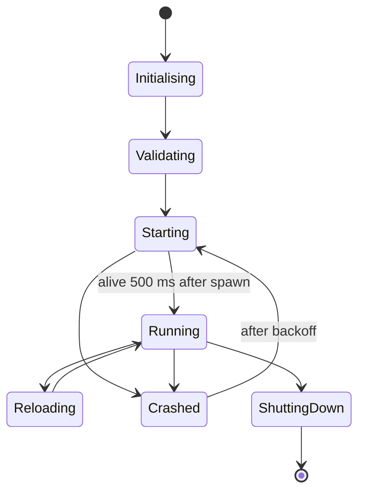

# dfe-transform-vector internals

Field-level depth under [architecture.md](architecture.md): how a config becomes the directory Vector reads, how reloads, crashes and shutdown run, what the ops port reports, and what the chart fixes.

## The config

The app's own config layers in this order, each over the one before:

1. The defaults, which [config-schema.yaml](config-schema.yaml) lists.
2. The config file: `--config`, else `config.yaml` or `config.yml` in the working directory.
3. `DFE_TRANSFORM_VECTOR_<SECTION>__<KEY>`, which reaches any key. A list takes brackets: `DFE_TRANSFORM_VECTOR_SOURCE__BROKERS='[a:9092,b:9092]'`.
4. The flat names, such as `DFE_TRANSFORM_VECTOR_SOURCE_BROKERS=a:9092,b:9092`, `_SINK_TOPIC`, `_TRANSFORMS_DIR`, `_VECTOR_BINARY` and the SASL pairs.

The working directory's `.env` is read into the environment before the env layers, and a variable already set wins. `--log-level`, `--log-format` and `--metrics-addr`, or `LOG_LEVEL`, `LOG_FORMAT` and `METRICS_ADDR`, outrank `logging.*` and `metrics.address`. Nothing reads `DFE_TRANSFORM_VECTOR_CONFIG`: name the file with `--config`, before any subcommand.

The same file seeds scalo's own cascade, so scalo's sections in it apply too: `version_check`, `scaling.enabled`, `scaling.memory_gate_threshold` and `metrics.namespace`. `dfe_source` fills in `<source>_land`, `<source>_load` and the consumer group, `dfe-transform-vector-<pipeline.name>` or `dfe-transform-vector-<source>` without a pipeline name, wherever the config leaves them at their defaults.

```yaml
pipeline:
  name: syslog-enrichment
source:
  brokers: ["kafka:9092"]     # or DFE_TRANSFORM_VECTOR_SOURCE_BROKERS
  topics:
    - raw_syslog_land
  group_id: dfe-transform-vector-syslog-enrichment
  sasl:
    mechanism: scram_sha_512
    # A mounted Secret holding `username` and `password` files. Vector reads
    # them through its directory secret backend, and expands no ${VAR}.
    secret_dir: /var/run/secrets/dfe-kafka
  tls:
    enabled: true
sink:
  brokers: ["kafka:9092"]     # or DFE_TRANSFORM_VECTOR_SINK_BROKERS
  topic: enriched_syslog_land
  key_field: ".org_id"
  compression: zstd
  sasl:                       # each endpoint has its own SASL and TLS
    mechanism: scram_sha_512
    secret_dir: /var/run/secrets/dfe-kafka
  tls:
    enabled: true
transforms:
  dir: /etc/dfe-transform-vector-transforms   # a file set's mountPath, see The chart
```

## The assembled directory

`dfe-transform-vector --config <file> assemble <dir>` writes what `run` hands Vector, without starting it.

| File | What it holds |
|---|---|
| `00_global.yaml` | `timezone: UTC`, `data_dir`, the API switch, one `directory` secret backend per credential source |
| `00_source.yaml` | `dfe_source`: a `kafka` source on bus, carrying the librdkafka layers in [librdkafka.md](librdkafka.md), or a `vector` source on `bridge.to_vector` on direct |
| `50_NNN_<file>` | Each transform file, in filename order, re-serialised with its wired `inputs` |
| `90_sink.yaml` | `dfe_sink`: on bus a `kafka` sink behind the `dfe_size_cap` filter, on direct a `vector` sink dialling `bridge.from_vector` |
| `99_observability.yaml` | `internal_metrics` into a `prometheus_exporter` on `metrics.vector_metrics_address` |
| `.secrets/` | Owner-only files for a SASL credential given as text |

Credentials appear only as references: `SECRET[dfe_source_sasl.username]` for a `secret_dir`, `SECRET[dfe_credentials.source_sasl_username]` for a credential given as text. The assembler refuses a `secret_dir` that lacks its `username` or `password` file.

`dfe_size_cap` drops a record whose encoded length is over the producer's `message.max.bytes` less 128 bytes for the key, headers and framing. `message.max.bytes` is scalo's pipeline-wide record ceiling of 16 MiB unless the central profile or `sink.librdkafka_options` sets it. librdkafka's own default of 1,000,000 bytes would refuse records the rest of the chain carries.

The wiring follows these rules:

- The source is always `dfe_source` and the sink always `dfe_sink`.
- A transform with no or empty `inputs` reads `dfe_source`, and an input written `source` becomes `dfe_source` in the file Vector reads.
- An input names a component (`parse`) or one of its named outputs (`split.accepted`). A `route` or `exclusive_route` has named outputs only, so a bare reference to one is refused.
- Every output nothing reads feeds the sink, through `dfe_size_cap` on bus, each unread route and its `_unmatched` included.
- A transform file declares only `transforms` and `enrichment_tables`. A `sources:` key, a `lua` transform, or a table outside `transforms.data_dir` or on a credential path is refused.
- Every `inputs` reference must resolve, every transform must be reachable from `dfe_source`, and the graph must have no cycle. The error names the component: `component 'enrich' references undefined input 'parser'`.
- Once every enrichment table file proves readable, `vector validate --no-environment` over the directory is the last gate.

## Hot reload

The watcher polls the config file and the `.yaml` and `.yml` files of `transforms.dir`, or the listed `transforms.files`, every `reload.poll_interval_secs` (30 by default). A SIGHUP to the supervisor starts the same reload. Enrichment table files are not watched, and with `reload.enabled: false` nothing is, and a SIGHUP is logged and ignored.

1. The config is re-read and validated.
2. A change to the app's own keys outside the `transforms` block is refused. The watcher logs `non-transform config changed -- requires pod restart`, counts `rejected`, and keeps the running config. The change stays in the file, so every later transform change is refused too until the pod restarts. scalo's sections in the file are read once at startup and not compared: an edit to one needs a restart, and the watcher reloads the transforms and counts `success` without applying it.
3. A transform change is assembled into `<config_dir>.next`, its table files checked and `vector validate` run there. A failure is logged and counted `error`, and the directory Vector reads is untouched.
4. The two directories swap in one `renameat2(RENAME_EXCHANGE)`, so a Vector restarted mid-reload reads the old one or the new one. A filesystem that cannot swap directories gets the files copied in place, which is not atomic.
5. Vector gets a SIGHUP, and its exporter is read for the outcome: `vector_reloaded_total` counts `success`, a refusal in `vector_component_errors_total` counts `error` and swaps the old directory back, and no answer within 60 s counts `unconfirmed`.

A failed attempt is retried on the same files after one poll interval, doubling to five minutes. `transform_vector_config_reloads_total{result}` carries `success`, `error`, `rejected` and `unconfirmed`. scalo's own `config_reloads_total{result}` counts `success` and `error`, a rejection included.

In a chart deployment an edit to the config or a file set rolls the pods anyway, because the chart hashes both into the pod template.

## The Vector subprocess



Startup runs in this order: the config loads and validates, the runtime binds the ops listener, `/readyz` starts reporting the lifecycle, `vector --version` is checked against `vector.version`, the directory is assembled, `vector validate` passes, the bridge binds its listeners on direct, and Vector is spawned. A failure before the spawn stops the process with its error.

Any exit Vector was not asked for is a crash, exit 0 included. `crashes_total` counts it, the lifecycle reads `Crashed`, and Vector is respawned after a backoff that starts at 1 s, doubles to 60 s and resets once a run has lasted five minutes. There is no crash limit, and `restarts_total` counts each respawn. One Vector runs per pod, and replicas scale out.

On SIGTERM or SIGINT the intake stops, Vector gets a SIGTERM and 55 s to exit before a SIGKILL, the bridge drains for up to 15 s, and the process exits 0. A failed bridge leg runs the same shutdown and exits non-zero.

At startup the supervisor also runs `vector --version` and compares the result with `vector.version`. `strict` and `warn` emit a security data-quality event on a mismatch, and no metric records it.

| `version_check` | On a mismatch |
|---|---|
| `strict` (the default) | Logs it and refuses to start |
| `warn` | Logs a warning and carries on |
| `disabled` | Runs no check, not even `vector --version` |

## Health and metrics

| Path | Answers |
|---|---|
| `/livez` | 200 while the ops listener answers |
| `/readyz` | 200 or 503, below |
| `/metrics` | The supervisor's metrics and every merged `vector_*` |
| `/scaling/pressure` | scalo's scaling pressure |

All of them are on `metrics.address`, 9090 by default. `/readyz` answers 503 `{"status":"starting"}` until the runtime hands the service over. A bus config with no topics then idles: 200, `pipeline_idle` 1, no Vector, until the config file names a topic. Once running, it answers 503 unless the lifecycle is `Running` or `Reloading`, and while the sink has held records for `metrics.sink_stall_secs` (60 by default) without delivering any. On direct the bridge's gRPC transports report there too. `Reloading` is entered only from `Running`, so a change landing mid crash-backoff cannot turn it to 200.

Metric names are bare unless `metrics.namespace` is set, and `dfe-transform-vector metrics-manifest` prints the catalogue. The supervisor's own:

- `transform_vector_lifecycle_state{state}`, 1 on the current state, and `pipeline_ready`.
- `crashes_total`, `restarts_total` and `uptime_seconds`, since the service started.
- `transform_vector_config_reloads_total{result}`, `config_reloads_total{result}` and `config_validation_errors_total`.
- `transform_vector_scrape_failures_total` and `transform_vector_sink_errors_total`.
- `records_received_total`, `records_processed_total`, `records_delivered_total` and `records_error_total`, derived from Vector's component counters on `dfe_source`, `dfe_sink` and `dfe_size_cap`.

The scrape reads Vector's exporter on scalo's metrics interval and re-registers every sample. A counter is set with `absolute` and carried across Vector restarts: a total that falls is a new Vector, and the old count becomes a base. A histogram arrives pre-aggregated, so each `_bucket` registers as a counter with its `le` label. A gauge Vector stops reporting is zeroed after `metrics.vector_metrics_expiry_ticks` scrapes, a counter is forgotten after 240, and at most 50,000 series merge.

The contract's ScaledObject scales on CPU and has no Kafka lag trigger. dfe-infra's values set a CPU target and, on its single, scale and mesh profiles, add a pressure trigger through `keda.extraTriggers`. The `scaling_pressure` this app publishes stays 0 while Vector runs, since nothing feeds it a component or a memory reading, and `spawn_circuit_gate_task` pins it to 0 while Vector is down.

## Delivery and dead letters

With `source.acknowledgements.enabled`, the default, delivery is at-least-once on both transports. On bus the sink's acknowledgements hold Vector's source offsets until delivery, so a crash redelivers from the last committed offset. On direct a push is answered once the next hop has it. With acknowledgements off, both happen at receipt.

On direct a record over the next stage's message-size ceiling goes to scalo's file DLQ, NDJSON under `/var/spool/scalo/dlq` on the contract's `dlq` writable path. With `dlq.enabled: false` it is dropped and counted in `pipeline_dead_letters_dropped_total{reason="too_large"}`. A record Vector refuses for good is dropped and counted under `reason="rejected"`, whatever `dlq` says. On bus no DLQ runs: the size cap's drops count under `too_large` and the Kafka sink's under `rejected`. Off the image the DLQ directory is not writable, so a direct run logs `DLQ enabled but no backend started` and leaves dead letters unacknowledged at their source: point `dlq.file.path` at a directory you can write.

On direct both bridge listeners lease the bytes they hold on scalo's memory guard. On bus Vector holds the records, bounded by its `buffer` settings and the container's memory limit.

`vector.data_dir` sits on the contract's `data` writable path, an emptyDir unless `writablePaths.data.persistence.enabled` gives it a claim, so a disk buffer outlives a Vector restart but not a pod. The supervisor logs `DISK BUFFER HAS NO DURABLE STORAGE` at startup when a disk buffer sits on ephemeral storage.

## Upgrading Vector

`VECTOR_VERSION` and the two archive checksums in `src/deployment.rs` are the only pin. The Dockerfile, the default `vector.version`, the contract's `default_config` and `scripts/fetch-vector.sh` all read the constant.

1. Change `VECTOR_VERSION`, and `VECTOR_SHA256_AMD64` and `VECTOR_SHA256_ARM64` from Vector's published `SHA256SUMS` for that release.
2. Regenerate the Dockerfile: `cargo run --bin dfe-transform-vector -- emit-dockerfile > Dockerfile`. `checked_in_dockerfile_matches_emit_dockerfile` fails while it drifts.
3. Move `services.vector` in dfe-infra's `versions.yaml` to the same release, tagged `<version>-alpine`. dfe-fetcher's container Vector extractor runs that image.
4. Release this repo. The full test tier, nightly and before a release, runs the `vector_validate` cases against the new Vector.

## The chart

No chart is committed. At release hyperi-ci runs `generate-artefacts` for the deployment contract and assembles a thin chart on the scalo-service library chart, at the version `release.helm.library` names in `.hyperi-ci.yaml`. The library renders the Deployment, Service, ConfigMap, ServiceAccount and KEDA ScaledObject, and its README documents the values.

`dfe-transform-vector emit-contract` prints what the contract fixes: the probes on the metrics port and their startup budget, the Push port while `config.source.transport` is `direct` or `grpc`, the Kafka Secret in `DFE_TRANSFORM_VECTOR_{SOURCE,SINK}_SASL_{USERNAME,PASSWORD}` and `DFE_TRANSFORM_VECTOR_KAFKA_SASL_MECHANISM`, the writable paths `data`, `run` and `dlq` beside the library's `/tmp` under a read-only root, the requests and limits, the grace period, and KEDA on CPU with no Kafka lag trigger.

The mounted config is the chart's `config` with `configOverrides` merged over it. The contract's `default_config` is never merged in, so the app's own defaults apply to anything a deployment leaves unset, `version_check: strict` included. The ConfigMap mounts over the config file's whole directory unless `configMount.subPath` is set, which hides the image's `/etc/dfe-transform-vector/transforms`: deliver transform files with a `fileSets` entry and point `transforms.dir` at its `mountPath`.

dfe-infra's `apps.yaml` declares the app `per_config`, so each source config gets its own Deployment, consumer group and ScaledObject. The app is in the default composition of `docker-single` only.
