# Vector

Vector is the child process in [dfe-transform-vector](architecture.md) that does the transform work. The supervisor spawns it, restarts it and merges its metrics.

| | |
|---|---|
| Repo | [hyperi-io/dfe-transform-vector](https://github.com/hyperi-io/dfe-transform-vector), `src/vector/`, `src/health.rs` and `src/metrics/` |
| Image and chart | `ghcr.io/hyperi-io/dfe-transform-vector`, which bakes the upstream Vector release `VECTOR_VERSION` pins in `src/deployment.rs` |
| Config reference | `vector`, `metrics` and `source.acknowledgements` in [config.example.yaml](../config.example.yaml) |
| Endpoints | `/livez`, `/readyz`, `/metrics` and `/scaling/pressure` on 9090. Vector's exporter on `127.0.0.1:9598`, loopback only |
| Metrics | `transform_vector_lifecycle_state`, `crashes_total`, `restarts_total` and every merged `vector_*` on `:9090/metrics` |

Vector is `Running` once it is alive 500 ms after spawn. An exit nobody asked for is a crash, followed by a restart after the backoff.

```mermaid
---
config:
  theme: base
  fontFamily: Inter, -apple-system, Segoe UI, Roboto, Helvetica, Arial, sans-serif
  themeVariables:
    fontSize: 15px
    lineColor: "#64748B"
    primaryTextColor: "#0F172A"
    actorBkg: "#FFFFFF"
    actorBorder: "#94A3B8"
    actorTextColor: "#0F172A"
    actorLineColor: "#64748B"
    signalColor: "#64748B"
    signalTextColor: "#0F172A"
    noteBkgColor: "#FFFFFF"
    noteBorderColor: "#94A3B8"
    noteTextColor: "#0F172A"
  themeCSS: >-
    .messageText{paint-order:stroke;stroke:#FFFFFF;stroke-width:3px;stroke-linejoin:round}
---
stateDiagram-v2
    direction LR
    accTitle: L4 Detail -- Vector lifecycle
    accDescr: The supervisor initialises and validates, then starts Vector. Vector is running once it is alive 500 ms after spawn, and a reload returns to running. A crash from starting or running waits out the backoff and starts again. Shutdown ends the lifecycle.
    state "Shutting down" as ShuttingDown
    [*] --> Initialising
    Initialising --> Validating
    Validating --> Starting
    Starting --> Running: settled
    Running --> Reloading: change
    Reloading --> Running: done
    Starting --> Crashed: exit
    Running --> Crashed: exit
    Crashed --> Starting: backoff
    Running --> ShuttingDown: SIGTERM
    ShuttingDown --> [*]
```

*Figure 1. L4 Detail -- Vector lifecycle.* Up: [L3 Components -- dfe-transform-vector](architecture.md).

## How it works

Of these states `/readyz` can answer 200 in `Running` and `Reloading` alone, and the sink and idle rules under Interfaces apply on top.

Startup runs in this order: the config loads and validates, the runtime binds the ops listener, `/readyz` starts reporting the lifecycle, `vector --version` is checked against `vector.version`, the directory is assembled, `vector validate` passes, the bridge binds its listeners on direct, and Vector is spawned. A failure before the spawn stops the process with its error.

Any exit Vector was not asked for is a crash, exit 0 included. `crashes_total` counts it, the lifecycle reads `Crashed`, and Vector is respawned after a backoff that starts at 1 s, doubles to 60 s and resets once a run has lasted five minutes. There is no crash limit, and `restarts_total` counts each respawn. One Vector runs per pod, and replicas scale out.

On SIGTERM or SIGINT the intake stops, Vector gets a SIGTERM and 55 s to exit before a SIGKILL, the bridge drains for up to 15 s, and the process exits 0. A failed bridge leg runs the same shutdown and exits non-zero.

On a version mismatch `strict` and `warn` emit a security data-quality event, and no metric records it.

| `vector.version_check` | On a mismatch |
|---|---|
| `strict` (the default) | Logs it and exits |
| `warn` | Logs a warning and continues |
| `disabled` | Runs no check, not even `vector --version` |

## Interfaces

| Path | Answers |
|---|---|
| `/livez` | 200 whenever the ops listener answers |
| `/readyz` | 200 or 503, below |
| `/metrics` | The supervisor's metrics and every merged `vector_*` |
| `/scaling/pressure` | scalo's scaling pressure |

All of them are on `metrics.address`, 9090 by default. `/readyz` answers 503 `{"status":"starting"}` until the runtime hands the service over. A bus config with no topics then idles: 200, `pipeline_idle` 1, no Vector, until the config file names a topic. Once running, it answers 503 unless the lifecycle is `Running` or `Reloading`, and when the sink has held or refused records for `metrics.sink_stall_secs` (60 by default) without delivering any. On direct the bridge's gRPC transports report there as well. `Reloading` is entered only from `Running`, so a change landing mid crash-backoff cannot turn it to 200.

## Scaling and failure

With `source.acknowledgements.enabled`, the default, delivery is at-least-once on both transports. On bus the sink's acknowledgements hold Vector's source offsets until delivery, so a crash redelivers from the last committed offset. On direct a push is answered once the next hop has it. With acknowledgements off, both answer at receipt.

On direct a record over the next stage's message-size ceiling goes to scalo's file DLQ, NDJSON under `/var/spool/scalo/dlq` on the contract's `dlq` writable path. With `dlq.enabled: false` it is dropped and counted in `pipeline_dead_letters_dropped_total{reason="too_large"}`. A record Vector rejects for good is dropped and counted under `reason="rejected"`, whatever `dlq` says. On bus a record over the producer's ceiling goes to `sink.dlq_topic` (see [Config engine](internals.md#interfaces)), counted in `vector_component_sent_events_total{component_id="dfe_dlq_sink"}` and in no drop counter. It counts under `too_large` only when the DLQ sink rejects it for good, or with `dlq.enabled: false`, and the Kafka sink's rejections count under `rejected`. When no enabled DLQ backend can start, such as a file DLQ with no writable directory off the image, a direct run logs `DLQ enabled but no backend started` and leaves dead letters unacknowledged at their source. Point `dlq.file.path` at a directory you can write.

On bus Vector holds the records, bounded by its `buffer` settings and the container's memory limit.

`vector.data_dir` sits on the contract's `data` writable path, an emptyDir unless `writablePaths.data.persistence.enabled` gives it a claim, so a disk buffer outlives a Vector restart but not a pod. The supervisor logs `DISK BUFFER HAS NO DURABLE STORAGE` at startup when a disk buffer sits on ephemeral storage.

## Key metrics

Metric names are bare unless `metrics.namespace` is set, and `dfe-transform-vector metrics-manifest` prints the catalogue. The supervisor's metrics:

- `transform_vector_lifecycle_state{state}`, 1 on the current state, and `pipeline_ready`.
- `crashes_total`, `restarts_total` and `uptime_seconds`, since the service started.
- `transform_vector_config_reloads_total{result}`, `config_reloads_total{result}` and `config_validation_errors_total`.
- `transform_vector_scrape_failures_total` and `transform_vector_sink_errors_total`.
- The record counters below, derived from Vector's component counters, since Vector and not the supervisor owns the Kafka client.

| Supervisor metric | Vector counter it reads |
|---|---|
| `records_received_total` | `vector_component_received_events_total{component_id="dfe_source"}` |
| `records_processed_total`, `records_delivered_total` | `vector_component_sent_events_total{component_id="dfe_sink"}` |
| `records_error_total` | `vector_component_discarded_events_total` on `dfe_sink`, `dfe_size_cap` and `dfe_dlq_sink` |
| `transform_vector_sink_errors_total` | `vector_component_errors_total{component_id="dfe_sink"}` |
| `pipeline_dead_letters_dropped_total{reason="too_large"}` | the growth of `vector_component_discarded_events_total` on `dfe_size_cap` and on `dfe_dlq_sink` |
| Dead letters held by the DLQ topic, with no supervisor counter of their own | `vector_component_sent_events_total{component_id="dfe_dlq_sink"}`, merged with the other `vector_*` series |
| `pipeline_dead_letters_dropped_total{reason="rejected"}` | the growth of `vector_component_discarded_events_total` on `dfe_sink` |

The scrape reads Vector's exporter on scalo's metrics interval and re-registers every sample. A failed scrape is not fatal: it counts `transform_vector_scrape_failures_total`, warns at most once every five minutes, and leaves readiness as it was. A response over 4 MiB is a failed scrape, not a partial merge. A counter is set with `absolute` and carried across Vector restarts: a total that falls is a restarted Vector, and the old count becomes a base. A histogram arrives pre-aggregated, so each `_bucket` registers as a counter with its `le` label. A gauge Vector stops reporting is zeroed after `metrics.vector_metrics_expiry_ticks` scrapes, a counter is forgotten after 240, and at most 50,000 series merge.

dfe-infra's values set a CPU target and, on its single, scale and mesh profiles, add a pressure trigger through `keda.extraTriggers`. The `scaling_pressure` this app publishes stays 0 when Vector runs, since nothing feeds it a component or a memory reading, and `spawn_circuit_gate_task` pins it to 0 when Vector is down.

## Related

- [Config engine](internals.md), what Vector is started on
- [Direct transport](direct-transport.md), the bridge on the direct path
- [librdkafka.md](librdkafka.md), the Kafka client Vector runs on the bus
